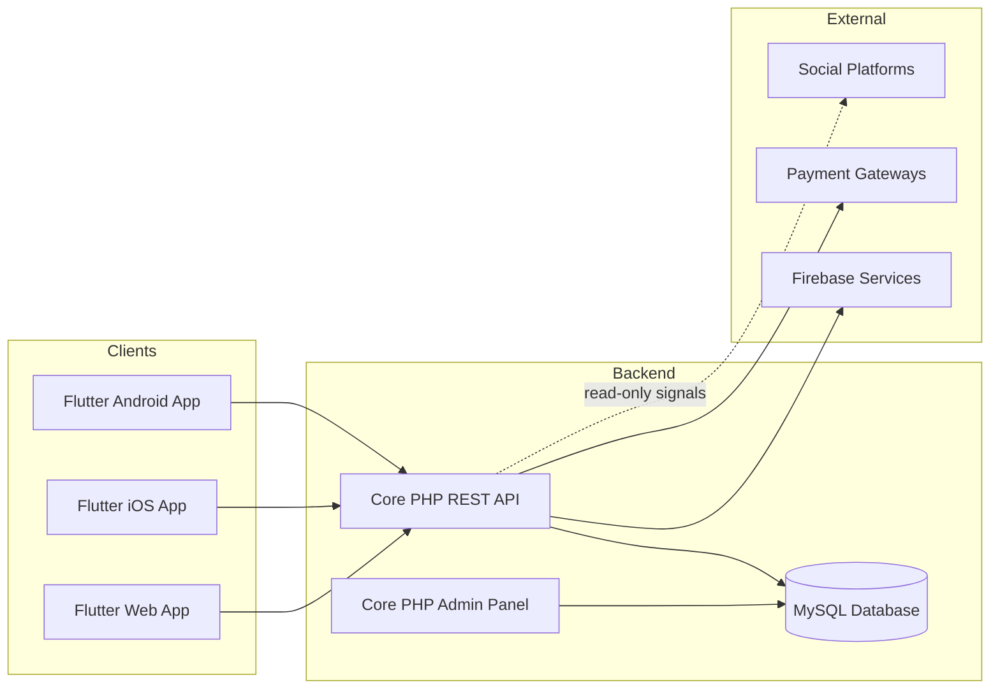

# Software Requirement Specification (SRS)
## Zuste — AI-Powered Influencer Marketplace Platform

| | |
|---|---|
| **Document Version** | 1.0 |
| **Prepared Date** | August 1, 2026 |
| **Structure Informed By** | IEEE 830 |
| **Related Documents** | `Zuste_PRD.md` · `Zuste_TRD.md` · `Zuste_Workflow.md` |

---

## Table of Contents
1. [Introduction](#1-introduction)
   - 1.1 [Purpose](#11-purpose)
   - 1.2 [Scope](#12-scope)
   - 1.3 [Definitions, Acronyms & Abbreviations](#13-definitions-acronyms--abbreviations)
   - 1.4 [References](#14-references)
2. [Overall Description](#2-overall-description)
   - 2.1 [Product Perspective](#21-product-perspective)
   - 2.2 [Product Functions](#22-product-functions)
   - 2.3 [User Characteristics](#23-user-characteristics)
   - 2.4 [Assumptions](#24-assumptions)
   - 2.5 [Constraints](#25-constraints)
3. [Functional Requirements](#3-functional-requirements)
4. [Non-Functional Requirements](#4-non-functional-requirements)
   - 4.1 [Performance](#41-performance)
   - 4.2 [Availability](#42-availability)
   - 4.3 [Scalability](#43-scalability)
   - 4.4 [Reliability](#44-reliability)
   - 4.5 [Accessibility](#45-accessibility)
   - 4.6 [Compatibility](#46-compatibility)
   - 4.7 [Localization](#47-localization)
   - 4.8 [Maintainability](#48-maintainability)
   - 4.9 [Backup Strategy](#49-backup-strategy)
   - 4.10 [Recovery Strategy](#410-recovery-strategy)
   - 4.11 [Logging](#411-logging)
   - 4.12 [Monitoring](#412-monitoring)

---

## 1. Introduction

### 1.1 Purpose
This Software Requirement Specification (SRS) defines the functional and non-functional requirements for Zuste, an AI-powered influencer marketplace platform. It is intended for the development team, QA, DevOps, and project stakeholders as the authoritative reference for what the system must do prior to implementation.

### 1.2 Scope
Zuste comprises: a Flutter mobile app (Android + iOS), a Flutter Web app, a Core PHP REST API backend, a Core PHP admin panel, a MySQL database, and Firebase services (Authentication, Cloud Messaging, Storage, Analytics, Crashlytics, Remote Config), deployed on a Hostinger VPS. The system enables three user types — Brand, Creator/Influencer, and Admin — to discover, negotiate, book, pay for, deliver, and review influencer marketing campaigns. Out of scope for this SRS version: video calling, live streaming, and multi-currency support (tracked as future features in the PRD).

### 1.3 Definitions, Acronyms & Abbreviations

| Term | Definition |
|---|---|
| Brand | A business user that books creators for campaigns |
| Creator | An influencer / content creator offering paid collaborations |
| KYC | Know Your Customer — identity verification process |
| Escrow | Funds held by the platform until a condition (work approval) is met |
| GMV | Gross Marketplace Value |
| JWT | JSON Web Token, used for stateless API authentication |
| PDO | PHP Data Objects, PHP's database abstraction layer |
| SRS | Software Requirement Specification (this document) |
| PWA | Progressive Web App |

### 1.4 References
- Zuste Product Requirement Document (`Zuste_PRD.md`)
- Zuste Technical Requirement Document (`Zuste_TRD.md`)
- Zuste Business Workflow Document (`Zuste_Workflow.md`)
- Zuste Complete Feature Documentation (project feature specification)

## 2. Overall Description

### 2.1 Product Perspective
Zuste is a new, standalone, three-sided marketplace product — it does not extend an existing system. It integrates with, but does not replace, external social platforms (Instagram, YouTube, Facebook, LinkedIn, Twitter, Snapchat, Pinterest) for creator identity/portfolio signals, and with external payment gateways (Razorpay, Stripe) and Firebase for auth, messaging, storage, and analytics.

### 2.2 Product Functions
At a high level, the system shall:
- Authenticate and manage three user types (Brand, Creator, Admin).
- Allow creators to build a public profile and portfolio, and set pricing/availability.
- Allow brands to search, filter, and discover creators.
- Manage the full booking lifecycle: request, negotiation, confirmation, delivery, completion.
- Process payments into escrow and release them (minus commission) on approval.
- Provide a wallet, transaction history, and withdrawal flow for creators and brands.
- Provide real-time chat between brands and creators.
- Send multi-channel notifications (push, email, SMS).
- Provide an admin panel for platform-wide management, moderation, and reporting.
- Surface AI-assisted recommendations, pricing suggestions, and fraud/fake-follower signals.

### 2.3 User Characteristics

| User Type | Technical Proficiency | Device Context | Key Concern |
|---|---|---|---|
| Brand | Low–medium; marketing professionals, not developers | Mobile + desktop web | Speed and trust in finding the right creator |
| Creator | Low–medium; comfortable with social apps | Primarily mobile | Getting paid on time, understanding requirements |
| Admin | Medium–high; internal ops staff | Desktop (admin panel) | Efficient moderation, dispute resolution, financial oversight |

### 2.4 Assumptions
- Users have a stable internet connection; offline-first behaviour is not required for v1.0.
- Creators already have an existing following on at least one supported social platform; Zuste does not grow a creator's audience directly.
- Payment gateways (Razorpay/Stripe) handle PCI-DSS compliance for card data; Zuste does not store raw card numbers.
- Firebase remains available and within its free/paid tier limits appropriate to platform scale.
- The Hostinger VPS is sized appropriately for projected launch traffic; scaling triggers a capacity review.

### 2.5 Constraints
- Backend and admin panel must be built in **Core PHP only** — no PHP framework (e.g., Laravel), no Node.js.
- Admin panel front-end must use **HTML5, Tailwind CSS, and vanilla JavaScript/AJAX only** — no React, Vue, Angular, or Bootstrap.
- Mobile and Web clients must be built in **Flutter** using **Riverpod** (state) and **GoRouter** (routing).
- Primary datastore is **MySQL**, accessed via **PDO** with prepared statements.
- Authentication tokens use **JWT**; identity/session bootstrapping uses **Firebase Authentication**.
- Deployment target is a **Hostinger VPS** running **Ubuntu + Nginx**.

## 3. Functional Requirements

Requirements are organized by module. Each requirement is uniquely identified for traceability to test cases.

| ID | Module | Requirement |
|---|---|---|
| SRS-FR-01 | Authentication | The system shall support registration/login via email+password, mobile OTP, Google, and Apple. |
| SRS-FR-02 | Authentication | The system shall issue a JWT access token and refresh token on successful login. |
| SRS-FR-03 | Authentication | The system shall allow password reset via a time-limited email or OTP-based token. |
| SRS-FR-04 | Onboarding | The system shall present a 3-screen onboarding sequence to first-time app users. |
| SRS-FR-05 | Profile | The system shall allow a creator to create/edit a profile with bio, photo, cover image, categories, languages, location, and social account links. |
| SRS-FR-06 | Profile | The system shall allow a creator to upload portfolio media (photos, videos, reels) to a gallery. |
| SRS-FR-07 | Profile | The system shall allow a creator to define one or more pricing packages tied to deliverable types. |
| SRS-FR-08 | Verification | The system shall require KYC document upload before a creator profile is marked "Verified." |
| SRS-FR-09 | Verification | The system shall provide an admin interface to approve/reject KYC submissions with a reason code. |
| SRS-FR-10 | Discovery | The system shall allow brands to perform keyword search across creator name, bio, and category tags. |
| SRS-FR-11 | Discovery | The system shall allow brands to filter search results by category, price range, location, follower range, rating, and platform. |
| SRS-FR-12 | Discovery | The system shall allow a brand to bookmark ("save") a creator profile for later retrieval. |
| SRS-FR-13 | Booking | The system shall allow a brand to create a campaign request specifying brief, deliverables, budget, and timeline. |
| SRS-FR-14 | Booking | The system shall allow a creator to accept, reject, or submit a counter-offer against a campaign request. |
| SRS-FR-15 | Booking | The system shall maintain a booking state machine: Requested → Negotiating → Confirmed → In Progress → Delivered → Completed, with Cancelled/Disputed as exception states. |
| SRS-FR-16 | Payment | The system shall calculate the total payable amount (budget + applicable tax) at booking confirmation. |
| SRS-FR-17 | Payment | The system shall route payment through Razorpay, Stripe, UPI, card, net banking, or wallet balance. |
| SRS-FR-18 | Payment | The system shall hold confirmed booking payments in an escrow ledger state until the brand approves delivered work. |
| SRS-FR-19 | Payment | The system shall deduct the configured commission percentage from escrow before crediting the creator wallet. |
| SRS-FR-20 | Payment | The system shall generate a GST-compliant invoice PDF for every completed transaction. |
| SRS-FR-21 | Wallet | The system shall maintain a running wallet balance and full transaction ledger per user. |
| SRS-FR-22 | Wallet | The system shall allow a creator to request withdrawal to a linked bank account, subject to a minimum threshold. |
| SRS-FR-23 | Wallet | The system shall route withdrawal requests to an admin approval queue before disbursement. |
| SRS-FR-24 | Chat | The system shall provide real-time messaging between a brand and creator scoped to a booking or general inquiry thread. |
| SRS-FR-25 | Chat | The system shall support image and PDF attachments, typing indicators, read receipts, and online-status display in chat. |
| SRS-FR-26 | Notifications | The system shall dispatch notifications for booking status changes, payments, messages, and campaign updates via push, email, or SMS based on user preference. |
| SRS-FR-27 | Reviews | The system shall allow both brand and creator to submit a rating (1–5) and written review after a booking reaches "Completed." |
| SRS-FR-28 | Admin | The system shall provide CRUD management for users, creators, categories, bookings, payments, wallets, and CMS content. |
| SRS-FR-29 | Admin | The system shall support role-based access control with distinct permission sets for Admin, Moderator, Support, and Finance roles. |
| SRS-FR-30 | Admin | The system shall record an immutable activity log entry for every state-changing admin action. |
| SRS-FR-31 | AI | The system shall generate a ranked creator recommendation list per brand based on search/booking history. |
| SRS-FR-32 | AI | The system shall generate a suggested price range for a proposed campaign based on similar historical bookings. |
| SRS-FR-33 | AI | The system shall compute a fraud-risk score for accounts/transactions exhibiting anomalous patterns and surface it to Admin. |

## 4. Non-Functional Requirements

### 4.1 Performance
- API endpoints shall respond within 500ms at p95 under nominal load (excluding third-party payment gateway round-trips).
- Search/filter queries shall return within 2 seconds for catalogues up to 100,000 creator profiles.

### 4.2 Availability
- The platform shall target 99.5% monthly uptime for the API and web app, excluding pre-announced maintenance.

### 4.3 Scalability
- The REST API shall be stateless (JWT-based) to allow horizontal scaling behind Nginx/load balancer as traffic grows.
- The database schema shall support read-replica scaling for reporting/analytics workloads without impacting transactional performance.

### 4.4 Reliability
- Financial operations (escrow hold, commission deduction, wallet credit/debit) shall be executed within database transactions to guarantee atomicity.
- The system shall retry transient failures (e.g., payment gateway timeouts) with idempotency keys to avoid duplicate charges.

### 4.5 Accessibility
- Mobile and web UI shall meet WCAG 2.1 AA contrast ratios for text and interactive elements.
- All interactive controls shall be reachable and operable via screen readers (TalkBack/VoiceOver) and keyboard navigation on web.

### 4.6 Compatibility
- Mobile apps shall support the current and previous major Android and iOS OS versions.
- Web app shall support the latest two versions of Chrome, Safari, Edge, and Firefox.

### 4.7 Localization
- The system architecture shall externalize all user-facing strings to support future multi-language rollout, even though only English ships at v1.0.
- Currency, date, and number formatting shall be locale-aware at the presentation layer.

### 4.8 Maintainability
- Backend code shall follow a consistent PSR-12-aligned coding style (see `Zuste_TRD.md`) with modular, documented functions to ease onboarding of new developers.
- Configuration (API keys, gateway credentials, Firebase config) shall be externalized to environment variables, never hard-coded.

### 4.9 Backup Strategy
- MySQL shall be backed up via automated daily full backups plus continuous binary-log incremental backups, retained for a minimum of 30 days.
- Media assets (Firebase Storage) shall rely on Firebase's built-in redundancy; a periodic export snapshot shall be retained for disaster-recovery purposes.

### 4.10 Recovery Strategy
- The system shall target a Recovery Point Objective (RPO) of ≤ 24 hours and a Recovery Time Objective (RTO) of ≤ 4 hours for the primary database.
- A documented rollback procedure shall accompany every production deployment (see `Zuste_TRD.md` § Deployment).

### 4.11 Logging
- All API requests shall be logged with request ID, endpoint, user ID (if authenticated), status code, and latency.
- Financial and admin actions shall be logged separately in an append-only audit log distinct from general application logs.

### 4.12 Monitoring
- The system shall expose health-check endpoints for uptime monitoring.
- Error rates, response latency, notification queue depth, and payment gateway failure rates shall be tracked on an operations dashboard with alerting thresholds.

---

*This SRS should be read alongside `Zuste_PRD.md` (product intent and business requirements) and `Zuste_TRD.md` (technical implementation standards).*
