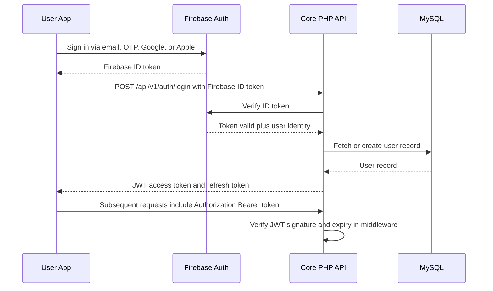

# Technical Requirement Document (TRD)
## Zuste — AI-Powered Influencer Marketplace Platform

| | |
|---|---|
| **Document Version** | 1.0 |
| **Prepared Date** | August 1, 2026 |
| **Related Documents** | `Zuste_PRD.md` · `Zuste_SRS.md` · `Zuste_Workflow.md` |

---

## Table of Contents
1. [Technology Stack](#1-technology-stack)
2. [Technology Constraints](#2-technology-constraints)
3. [Project & Folder Structure](#3-project--folder-structure)
4. [Coding Standards](#4-coding-standards)
5. [Naming Conventions](#5-naming-conventions)
6. [API Standards](#6-api-standards)
7. [Authentication Flow](#7-authentication-flow)
8. [Database Standards](#8-database-standards)
9. [Error Handling](#9-error-handling)
10. [Validation](#10-validation)
11. [Caching](#11-caching)
12. [Security](#12-security)
13. [Deployment](#13-deployment)
14. [Optimization](#14-optimization)
15. [Monitoring](#15-monitoring)

---

## 1. Technology Stack

| Layer | Technology |
|---|---|
| Mobile | Flutter (latest stable), Riverpod, GoRouter, Material 3 |
| Web | Flutter Web (responsive / PWA) |
| Backend | Core PHP 8.3, REST API, JWT authentication, PDO |
| Database | MySQL |
| Admin Panel | Core PHP, HTML5, Tailwind CSS, vanilla JavaScript, AJAX |
| Cloud Services | Firebase Authentication, Cloud Messaging, Storage, Analytics, Crashlytics, Remote Config |
| Hosting / Infra | Hostinger VPS, Ubuntu, Nginx |

## 2. Technology Constraints

To keep the stack lean and fully within the team's Core-PHP/Flutter expertise, the following are **explicitly excluded**:

| Excluded | Rationale |
|---|---|
| PHP frameworks (Laravel, Symfony, etc.) | Avoid framework overhead/lock-in; team standardizes on Core PHP |
| Node.js | No JS backend runtime; all server logic is Core PHP |
| React, Vue, Angular | Admin panel stays framework-free (HTML5 + Tailwind + vanilla JS/AJAX) |
| Bootstrap | Tailwind CSS is the sole CSS utility framework |

Any future proposal to introduce one of the above requires a documented architecture-review decision, not an ad-hoc addition.

## 3. Project & Folder Structure

### 3.1 Backend (Core PHP REST API)
```
/api
  /config          -> env loader, DB connection, Firebase/JWT config
  /core            -> base Router, Request, Response, Middleware classes
  /middleware      -> AuthMiddleware, RoleMiddleware, RateLimitMiddleware
  /modules
    /auth
    /users
    /creators
    /bookings
    /wallet
    /payments
    /chat
    /notifications
    /admin
  /helpers         -> validation, formatting, response envelope helpers
  /uploads         -> local temp storage before pushing to Firebase Storage
  /vendor          -> composer dependencies (JWT lib, PDO helpers only, no framework)
  index.php        -> single entry point / front controller
```

### 3.2 Admin Panel (Core PHP + Tailwind + AJAX)
```
/admin
  /assets          -> compiled Tailwind CSS, vanilla JS
  /views           -> PHP view templates per module (users, creators, bookings, ...)
  /controllers     -> one controller per module, calls /api internally or shares /core
  /includes        -> header, sidebar, footer partials
```

### 3.3 Flutter App (Mobile + Web)
```
/lib
  /core            -> theming, constants, network client, error handling
  /router          -> GoRouter route definitions
  /providers       -> Riverpod providers (state)
  /features
    /auth
    /discovery
    /creator_profile
    /booking
    /chat
    /wallet
    /notifications
  /shared_widgets
main.dart
```

## 4. Coding Standards

- **PHP:** Follow PSR-1/PSR-12 formatting conventions (even without a framework) — 4-space indentation, one class per file, strict typing (`declare(strict_types=1);`) in all new files.
- **Dart/Flutter:** Follow the official Dart style guide and `flutter_lints` recommended rule set; run `dart format` pre-commit.
- **JavaScript (admin panel):** ES6+, no build step required; keep AJAX calls in a shared `api.js` module rather than inlined per page.
- All modules require inline documentation (PHPDoc / Dart doc comments) for public functions and classes.
- No business logic in view/template files — views render data prepared by controllers only.

## 5. Naming Conventions

| Element | Convention | Example |
|---|---|---|
| PHP classes | PascalCase | `BookingController`, `WalletService` |
| PHP functions/methods | camelCase | `createBooking()`, `releaseEscrow()` |
| Database tables | snake_case, plural | `bookings`, `wallet_transactions` |
| Database columns | snake_case | `created_at`, `commission_rate` |
| REST endpoints | kebab-case, plural nouns | `/api/v1/campaign-requests` |
| Dart classes | PascalCase | `BookingRepository`, `CreatorProfileScreen` |
| Dart files | snake_case | `booking_repository.dart` |
| Riverpod providers | camelCase + `Provider` suffix | `bookingListProvider` |
| Environment variables | UPPER_SNAKE_CASE | `DB_HOST`, `JWT_SECRET`, `FIREBASE_PROJECT_ID` |

## 6. API Standards

- **Versioning:** All endpoints are prefixed `/api/v1/...`; breaking changes ship under `/api/v2/...` rather than mutating v1.
- **Response envelope:**
```json
{
  "success": true,
  "data": {},
  "message": "Booking created successfully",
  "errors": null
}
```
- **HTTP methods:** `GET` (read), `POST` (create), `PUT`/`PATCH` (update), `DELETE` (remove) — no verbs in URLs, with the exception of explicit state-transition actions such as `/bookings/{id}/accept`.
- **Pagination:** cursor or page-based via `?page=&limit=` query params; response includes `meta: { total, page, limit }`.
- **Status codes:** `200` success, `201` created, `400` validation error, `401` unauthenticated, `403` unauthorized, `404` not found, `409` conflict (e.g., double booking), `422` unprocessable entity, `429` rate-limited, `500` server error.

## 7. Authentication Flow



- Firebase Authentication handles the initial identity proof (email/OTP/Google/Apple sign-in).
- The Core PHP API independently verifies the Firebase ID token server-side, then issues its own short-lived **JWT access token** (e.g., 15–60 min) plus a longer-lived **refresh token** for session continuity.
- `AuthMiddleware` validates the JWT on every protected route; expired tokens return `401` with a `token_expired` error code so the client knows to refresh rather than re-login.

## 8. Database Standards

- All tables use the `InnoDB` engine for transactional integrity and foreign-key support.
- Every table has `id` (primary key, auto-increment or UUID), `created_at`, `updated_at`; soft-deletable tables also carry `deleted_at`.
- Foreign keys are explicitly declared with `ON DELETE RESTRICT` (financial tables) or `ON DELETE CASCADE` (purely dependent child records, e.g., chat message attachments).
- Monetary columns use `DECIMAL(12,2)`, never `FLOAT`/`DOUBLE`.
- All queries go through **PDO with prepared statements**; no raw string concatenation of user input into SQL.
- Indexes are added for all foreign keys and for columns used in search/filter (`category_id`, `price`, `location`, `rating`, `status`).
- Schema changes are managed through versioned migration scripts (`/migrations/YYYYMMDDHHMM_description.sql`), applied sequentially and tracked in a `migrations` table.

## 9. Error Handling

- A single global exception handler in `index.php` catches uncaught exceptions and returns the standard error envelope — no raw PHP stack traces are ever returned to the client.
- Application-level errors use typed exception classes (`ValidationException`, `NotFoundException`, `PaymentException`, `AuthException`) mapped to specific HTTP status codes.
- All caught exceptions are logged server-side (see § 15 Monitoring) with a correlation/request ID that is also returned to the client for support reference.

## 10. Validation

- Every API endpoint defines an explicit validation schema (required fields, types, min/max, enum values) executed before any business logic runs.
- Server-side validation is authoritative; client-side (Flutter form) validation is for UX only and never trusted alone.
- File uploads (KYC documents, portfolio media) are validated for MIME type, extension, and size limits before being forwarded to Firebase Storage.

## 11. Caching

- **Application-level:** PHP OPcache enabled in production for compiled bytecode caching.
- **HTTP-level:** Cacheable GET endpoints (e.g., category list, CMS pages) send appropriate `Cache-Control`/`ETag` headers.
- **Database-level:** Frequently-read, rarely-changed lookups (categories, platform list) are cached in a small in-memory/file cache layer with explicit invalidation on admin edits.
- **Future consideration:** Redis/Memcached may be introduced for session and hot-query caching if load testing shows the file-based cache is insufficient — this is not part of the v1.0 stack and requires an architecture-review sign-off per §2.

## 12. Security

| Area | Standard |
|---|---|
| Transport | HTTPS/TLS enforced everywhere (HSTS enabled); no plain HTTP endpoints |
| Passwords | Hashed with `password_hash()` (bcrypt/Argon2id), never reversible encryption |
| Tokens | JWT signed with a strong secret/algorithm (HS256 or RS256), short expiry + refresh rotation |
| CSRF | Admin panel forms include CSRF tokens validated server-side on every state-changing request |
| XSS | All output escaped (`htmlspecialchars`) in admin views; API responses are JSON, not HTML, by default |
| SQL Injection | PDO prepared statements exclusively; no dynamic SQL built from raw input |
| Rate Limiting | Login, OTP, and password-reset endpoints are rate-limited per IP/account to prevent brute force |
| File Uploads | Type/size validation, stored outside the web root or in Firebase Storage, served via signed URLs |
| Secrets | API keys, DB credentials, and gateway secrets live in environment variables, excluded from version control |
| Audit | All financial and admin actions write to an append-only activity log |

## 13. Deployment

- **Target:** Hostinger VPS running Ubuntu, fronted by Nginx as reverse proxy / static file server, PHP-FPM for application execution.
- **Environments:** `local` → `staging` → `production`, each with isolated `.env` configuration and database.
- **SSL:** Let's Encrypt certificates via Certbot, auto-renewed via cron.
- **Cron jobs:** scheduled tasks for escrow auto-reminders, notification digests, backup triggers, and log rotation.
- **Rollback plan:** each deploy tags the previous release directory (`releases/{timestamp}`); a symlink switch (`current -> releases/{timestamp}`) enables instant rollback without redeploying.
- **Zero/low-downtime releases:** new release built in a fresh directory, dependencies installed, migrations run, then the symlink is atomically swapped.

## 14. Optimization

- Database queries reviewed for N+1 patterns; list endpoints use joins/eager-loading of related data instead of per-row queries.
- Images (portfolio, gallery) are resized/compressed on upload before storage; the app requests appropriately sized variants rather than full-resolution originals.
- API responses are paginated by default; no unbounded list endpoints.
- Gzip/Brotli compression enabled at the Nginx layer for text-based responses.

## 15. Monitoring

- Health-check endpoint (`/api/v1/health`) for uptime monitors.
- Centralized application and error logs, rotated daily, retained 30 days minimum.
- Key operational metrics tracked: API latency (p50/p95/p99), error rate, payment gateway success/failure rate, notification delivery rate, and queue backlog (if async workers are introduced).
- Alerting thresholds configured for elevated error rate, failed payment spikes, and disk/CPU/memory pressure on the VPS.

---

*This TRD should be read alongside `Zuste_SRS.md` (functional/non-functional requirements) and `Zuste_Workflow.md` (process flows that these standards must support).*
