# Business Workflow Document
## Zuste — AI-Powered Influencer Marketplace Platform

| | |
|---|---|
| **Document Version** | 1.0 |
| **Prepared Date** | August 1, 2026 |
| **Related Documents** | `Zuste_PRD.md` · `Zuste_SRS.md` · `Zuste_TRD.md` |

---

## Table of Contents
- [0. Campaign Lifecycle — End-to-End](#0-campaign-lifecycle--end-to-end)
- [1. Lead Generation Workflow](#1-lead-generation-workflow)
- [2. Registration Workflow](#2-registration-workflow)
- [3. Creator Verification (KYC) Workflow](#3-creator-verification-kyc-workflow)
- [4. Booking Workflow](#4-booking-workflow)
- [5. Approval Workflow](#5-approval-workflow)
- [6. Payment (Escrow) Workflow](#6-payment-escrow-workflow)
- [7. Commission Workflow](#7-commission-workflow)
- [8. Refund Workflow](#8-refund-workflow)
- [9. Settlement Workflow](#9-settlement-workflow)
- [10. Support Workflow](#10-support-workflow)
- [11. Notification Workflow](#11-notification-workflow)

---

## 0. Campaign Lifecycle — End-to-End

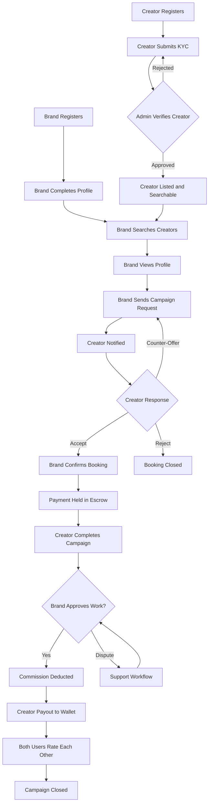

This is the master flow; every workflow below is a detailed view of one segment of this lifecycle.

## 1. Lead Generation Workflow

Covers how a first-time visitor becomes a registered brand or creator.

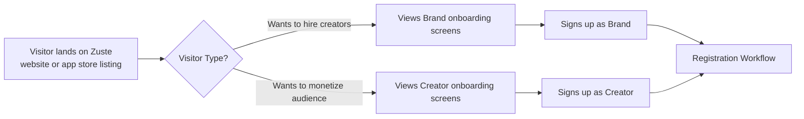

**Notes**
- Marketing channels (app store, referrals, ads) feed into the same onboarding entry point; the 3-screen onboarding (Brand Discovery, Verified Creators, Collaboration) is shown regardless of eventual user type, with a role choice at sign-up.

## 2. Registration Workflow

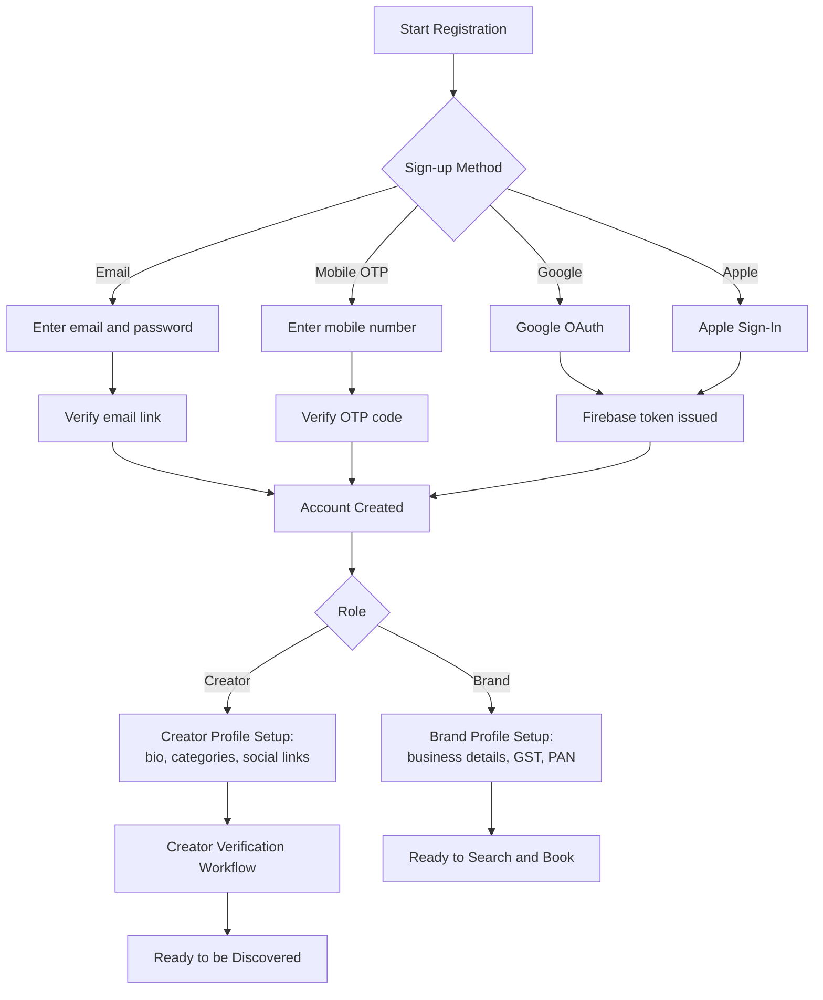

## 3. Creator Verification (KYC) Workflow

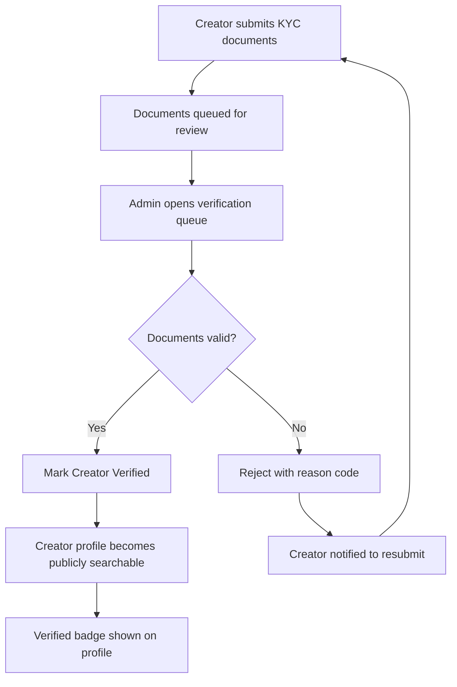

## 4. Booking Workflow

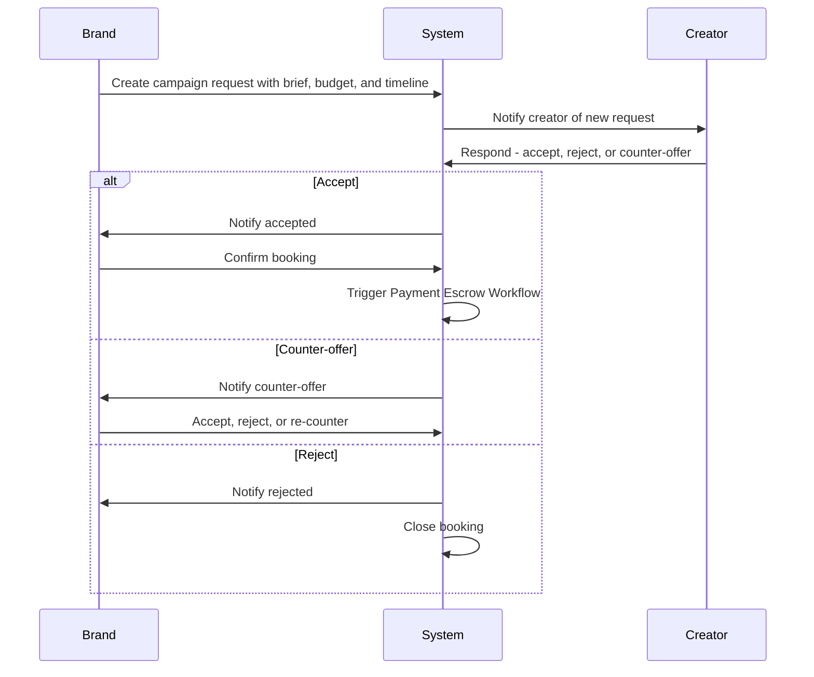

## 5. Approval Workflow

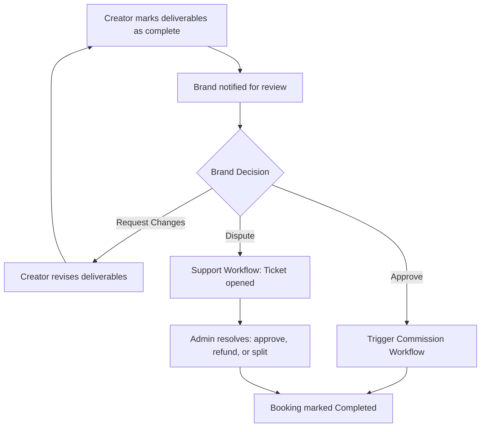

## 6. Payment (Escrow) Workflow

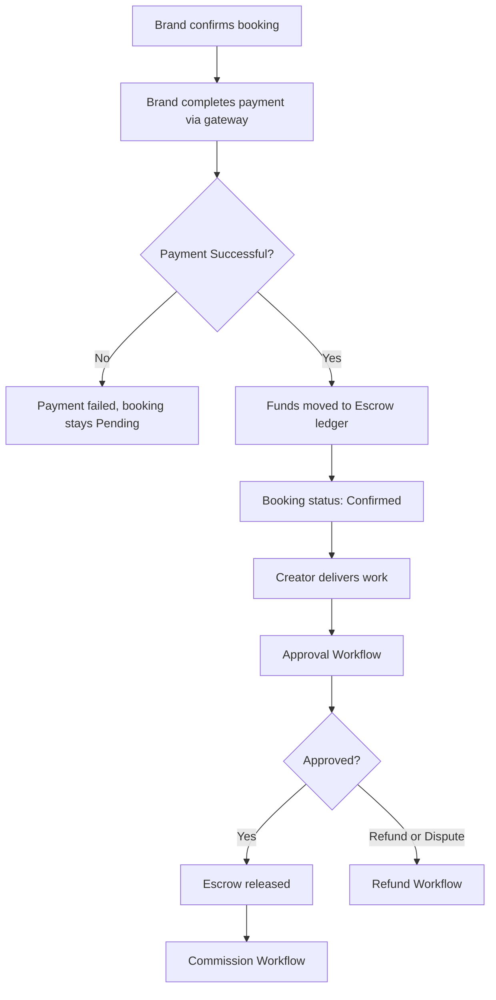

## 7. Commission Workflow

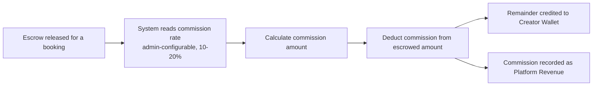

## 8. Refund Workflow

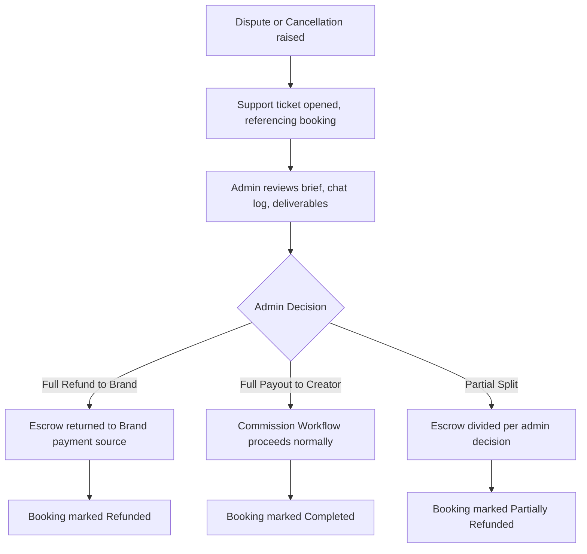

## 9. Settlement Workflow

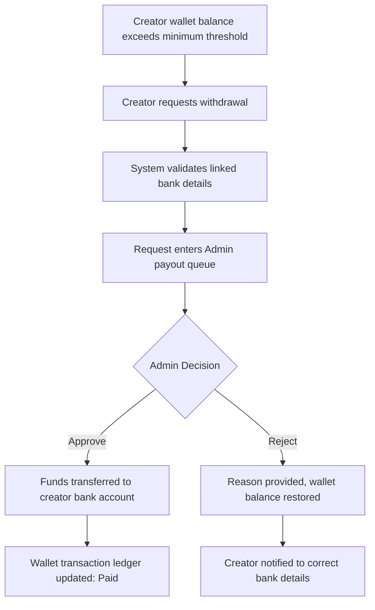

## 10. Support Workflow

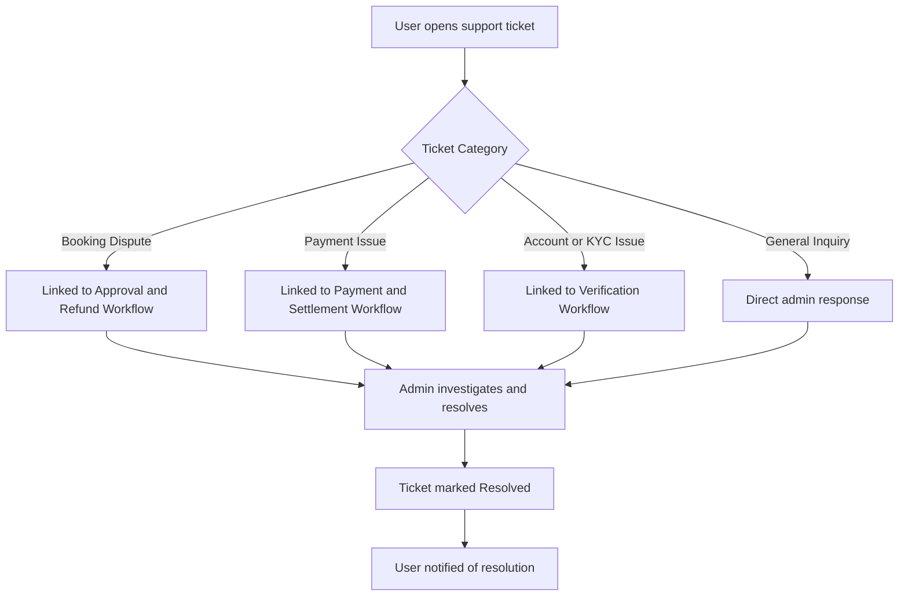

## 11. Notification Workflow

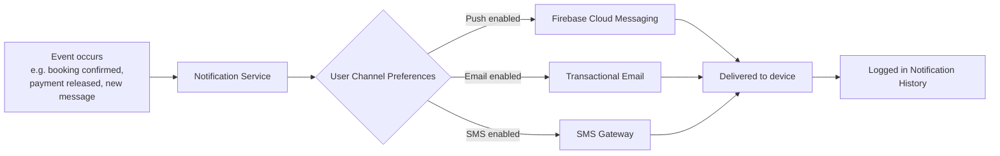

---

*This document should be read alongside `Zuste_PRD.md`, `Zuste_SRS.md`, and `Zuste_TRD.md`. Diagrams use Mermaid syntax and render automatically in most Markdown viewers, including GitHub and the Claude interface.*
